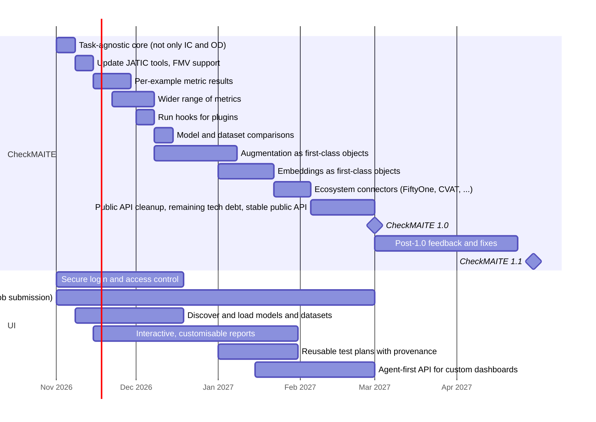

# Roadmap

<!-- markdownlint-disable MD013 -- table rows and chart lines cannot be wrapped -->

<!-- --8<-- [start:roadmap] -->

**Last updated:** 2026-10-28

This roadmap covers CheckMAITE and the CheckMAITE UI. It is a draft for
discussion. Dates are indicative and will move as priorities are agreed.

## Planned releases

| Release | Planned date |
| --- | --- |
| CheckMAITE 1.0 | 1 Mar 2027 |
| CheckMAITE 1.1 | 30 Apr 2027 |

## CheckMAITE

| Item | What it means | Start | End | Maximum time to complete | Estimated impact |
| --- | --- | --- | --- | --- | --- |
| Task-agnostic core (not only IC and OD) | Image classification (IC) and object detection (OD) are currently hard-coded as the only tasks. Restructure the core so new tasks, such as tracking for FMV, can be added without changing it. | 1 Nov 2026 | 7 Nov 2026 | 1 week | High |
| Update JATIC tools, FMV support | Move to the latest JATIC tool versions, add video (FMV) evaluation, and pick up new features. dataeval-flow is a source of ideas. | 8 Nov 2026 | 14 Nov 2026 | 1 week | High |
| Per-example metric results | Metrics calculated for every image and box, not only averaged over the dataset, so results can be broken down by condition and failures traced to specific examples. This needs clearer explanation to users. | 15 Nov 2026 | 28 Nov 2026 | 2 weeks | High |
| Wider range of metrics | More standard metrics, for example for calibration and for the new tasks. | 22 Nov 2026 | 7 Dec 2026 | 2 weeks | Medium |
| Run hooks for plugins | Hooks, like pytest's plugin hooks, that let other packages run their own code when a run starts or finishes, for example to send results to MLflow or check a model before it runs. | 1 Dec 2026 | 7 Dec 2026 | 1 week | Low |
| Model and dataset comparisons | Compare models or datasets side by side, with confidence intervals so real differences can be told from noise. | 8 Dec 2026 | 14 Dec 2026 | 1 week | High |
| Support augmentation as first-class objects | Any capability can run under an augmentation, recorded with the run. Later this allows adversarial attacks through ModelMAITE, like HEART. | 8 Dec 2026 | 7 Jan 2027 | 3 weeks | High |
| Support embeddings as first-class objects | Compute image embeddings once and reuse them across checks. Possibly upstream to MAITE. | 1 Jan 2027 | 21 Jan 2027 | 3 weeks | Medium |
| Ecosystem connectors (FiftyOne, CVAT, ...) | Work with FiftyOne, CVAT, model registries and similar tools. | 22 Jan 2027 | 4 Feb 2027 | 2 weeks | Medium |
| Public API cleanup, remaining tech debt, stable public API | Tidy the imports, clear any technical debt still outstanding, and commit to a stable, documented public API. | 5 Feb 2027 | 28 Feb 2027 | 3 weeks | High |
| CheckMAITE 1.0 | Release milestone. | 1 Mar 2027 | 1 Mar 2027 | | |
| Post-1.0 feedback and fixes | Address user feedback and issues found after the 1.0 release. | 1 Mar 2027 | 23 Apr 2027 | 8 weeks | Medium |
| CheckMAITE 1.1 | Feature release. | 30 Apr 2027 | 30 Apr 2027 | | |

## UI

| Item | What it means | Start | End | Maximum time to complete | Estimated impact |
| --- | --- | --- | --- | --- | --- |
| Secure login and access control | Sign-in, projects and roles that control who can see and run what. Also explore what it would take to run outside Nebari. | 1 Nov 2026 | 18 Dec 2026 | 1.5 months | High |
| Discover and load models and datasets | Browse the available models and datasets, and load them for evaluation from the UI. | 8 Nov 2026 | 18 Dec 2026 | 6 weeks | High |
| Interactive, customisable reports | Explore, compare and share results, with dashboard-style views, and add your own report formats. Superset is one source of ideas. | 15 Nov 2026 | 30 Jan 2027 | 2 months | High |
| Reusable test plans with provenance | Save test plans to files, load them back and run them from the UI, with a record of the data, models, settings and versions behind every result. | 1 Jan 2027 | 30 Jan 2027 | 4 weeks | High |
| Agent-first API for custom dashboards | An API agents can use to build custom dashboards. | 15 Jan 2027 | 28 Feb 2027 | 6 weeks | High |
| Technical debt (ongoing) | UI performance, typing and styling, API performance, database schemas, and more reliable job submission. | 1 Nov 2026 | 28 Feb 2027 | 3.5 months | N/A |

## Key dependencies

Only the dependencies that decide the order of work are shown. Each item must
come before the item it points to.

- Per-example metric results → Model and dataset comparisons
- Per-example metric results → Interactive, customisable reports
- Interactive, customisable reports → Agent-first dashboard API
- ModelMAITE extension mechanism (gradients, features, class scores) →
  Augmentation as first-class objects

## Timeline

The same dates as a chart.

<!-- --8<-- [end:roadmap] -->
