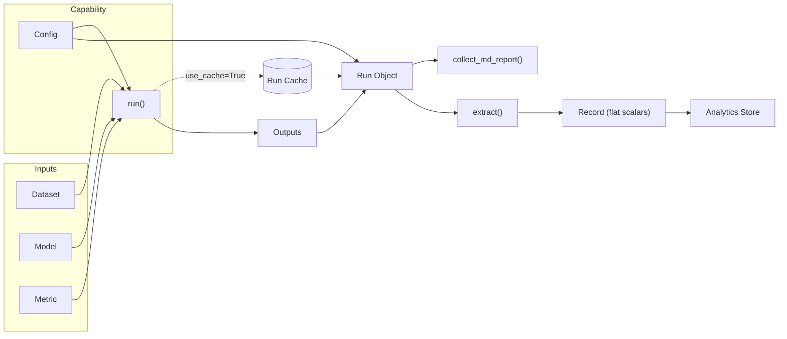
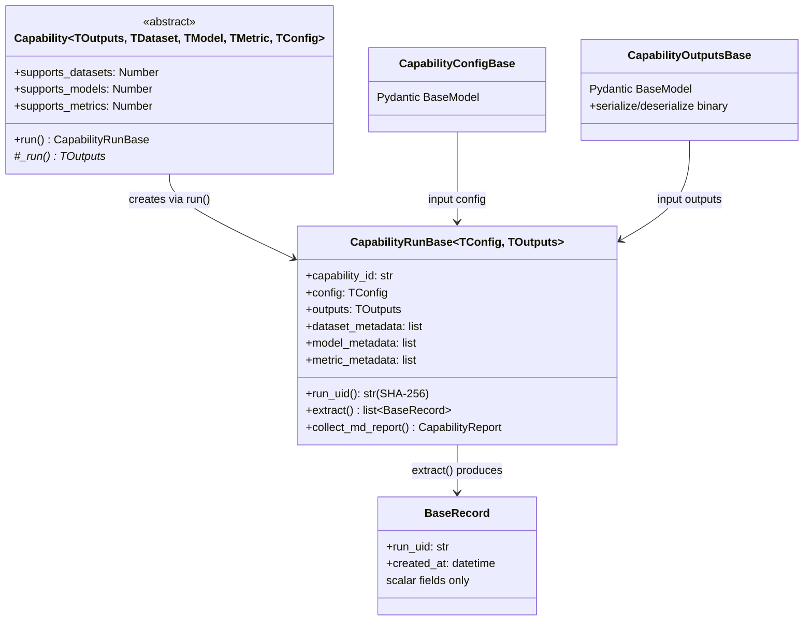
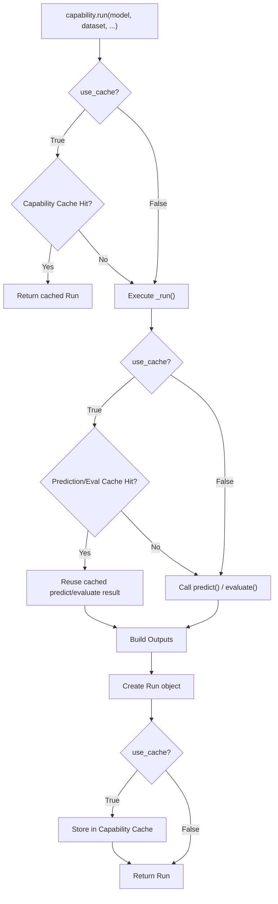
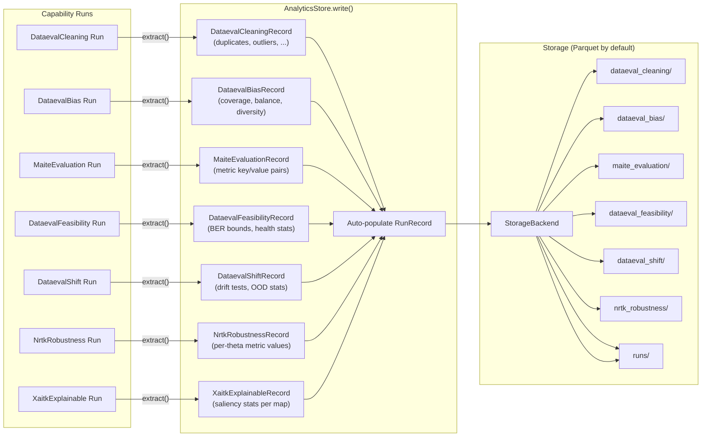

# Key Concepts: Capabilities, Runs, and Caching

This page documents the core abstractions used to define, execute, and cache
evaluations: **Capabilities**, **Runs**, and the **caching layer**.

<!-- Top-level flowchart notes (2026-03-20):
     - Shows run() (public API), not _run() (internal abstract method)
     - Cache check happens inside run() before _run() executes — see capability_core.py:363-386
     - Config and Outputs both flow into the Run Object (they are constructor inputs)
     - Simplified: does not show the "store in cache after compute" path
       (covered in caching flowchart below) -->


---

## Core Concepts

### Capability

A **Capability** represents a specific evaluation task — for example, running
model inference and computing metrics on a dataset. It is the top-level
abstraction that users interact with.

A Capability is responsible for:

- Defining the **configuration** accepted by the evaluation (via a `Config` object)
- Knowing how to **execute** an evaluation (`_run`)
- Knowing how to **check the cache** before executing (handled by `run`)

---

### Run

A **Run** is an object that stores everything associated with a *specific
execution* of a Capability. This includes:

- The **configuration** for that execution (e.g., model, dataset, metric settings)
- The **outputs** produced (e.g., predictions, metric results)
- An optional `collect_md_report()` implementation returning a typed inline or
  artifact report for those outputs

CheckMAITE uses Pydantic to serialize cache entries. It directly supports common
objects such as NumPy arrays and Torch tensors by saving their data in separate
binary files. If saving fails, CheckMAITE cleans up partial files. Cache links
are only followed while loading the cache, so similar-looking user strings
remain strings.

<!-- Note: The exported name is binary_de_serializer (with underscore),
not binary_deserializer. -->
To cache another type, register a codec with
`binary_de_serializer.register(...)`. The codec supplies functions that convert
the value to bytes and restore it. Strict mode uses a custom codec only when the
codec also identifies which values have a lossless round trip.

---

### Implementing a New Capability

Each tool must implement:

1. **`Config`** — A Pydantic model declaring what configuration options the
   Capability accepts. Can be `pass` if no configuration is needed.
2. **`Outputs`** — A Pydantic model declaring what outputs will be stored and cached.
3. **`Run`** — Contains the `Config`, the `Outputs`, and the
   `collect_md_report()` method for report generation.
4. **Capability class** — aka the "Runner". Implements `_run(...)`, the actual
   execution logic. Calls internal helpers (e.g., `maite_evaluate`) to produce
   outputs.

<!-- Class diagram notes (2026-03-20):
     - run_uid is a @cached_property (capability_core.py:140) — shown with () to
       indicate it's computed
     - Config and Outputs arrows point INTO RunBase (they are inputs, not outputs)
     - collect_md_report() omits the required threshold param for diagram
       simplicity -->


See the **Baseline Evaluation Capability** for the simplest implementation.

---

## Caching

The caching layer is designed to avoid redundant computation. There are two
levels of caching:

<!-- Caching flowchart notes (2026-03-20):
     - Capability-level cache: implemented in capability_core.py:363-386
     - Prediction/eval cache: delegated to each capability's _run() implementation
       via use_prediction_and_evaluation_cache param — not a framework-level
       mechanism -->


### 1. Capability-level Cache

When a Capability is executed with `use_cache=True` (the default), it checks
whether a Run with the same configuration and inputs has already been completed.
If a cache hit is found, the stored Run object is returned immediately — no
computation occurs.

### 2. Prediction/Evaluation Cache

At a lower level, individual `predict` and `evaluate` calls (e.g., calls to
`maite.evaluate`) are also cached globally. If two different Capabilities within
the same pipeline call `evaluate` with the same model, dataset, and metric
configuration, the second call will reuse the result from the first.

This cache is controlled by the same `use_cache` flag. When `use_cache=False`,
both the capability-level and prediction/evaluation-level caches are bypassed.

> **Note:** It is not currently possible to disable the prediction/evaluation
> cache independently of the capability cache. Both are toggled together via
> `use_cache`.

### MAITE Execution and Ownership Semantics

CheckMAITE treats `maite.tasks.evaluate()` as the fundamental task.
`cached_tasks.predict()` is the convenience form of
`evaluate(metric=None, return_preds=True)`. On a cold evaluation, MAITE applies
augmentation, calls the model, updates the metric, and optionally retains each
batch for return—all in one pass.

MAITE passes the same batch objects between these steps; it does not make
defensive copies. CheckMAITE follows that ownership model and assumes:

- model and augmentation adapters return stable outputs that remain valid after
  later batches are processed;
- `metric.update(predictions, targets, metadata)` treats all three arguments as
  read-only; and
- callers do not depend on Python alias identity or mutate returned values
  expecting the cache to change.

CheckMAITE validates batch alignment, but it does not snapshot arrays or tensors
before metric updates. A metric that mutates a prediction can therefore also
alter the value returned to the caller or published to the prediction cache. A
model that repeatedly returns and overwrites the same mutable output buffer can
similarly make earlier batches appear to contain the final batch. Such adapters
and metrics are outside the supported contract and should copy internally when
they need mutable working storage.

#### Multi-Metric Evaluation

Image-classification and object-detection `MaiteEvaluation` capabilities accept
one or more metrics. CheckMAITE presents the collection to MAITE as one internal
fanout metric, so augmentation and model inference happen once per batch even
when `use_cache=False`. Member metrics receive the same prediction, target, and
metadata objects in canonical metric-ID order.

```python
run = MaiteEvaluation().run(
    models=[model],
    datasets=[dataset],
    metrics=[accuracy, recall],
    use_cache=False,
)

accuracy_result = run.outputs.metrics[accuracy.metadata["id"]]
print(accuracy_result.result)
print(accuracy_result.overall_metric_value)
```

Metric metadata IDs must be non-empty and unique. CheckMAITE sorts metrics by ID
before evaluation, run identity generation, reports, and analytics, so reversing
caller order does not create a different run. Any member failure immediately
aborts the complete evaluation with a `MaiteEvaluationMetricError` identifying
the member and lifecycle stage. Partial capability runs are not returned.

#### Retained Data and Memory

`return_preds=True` asks MAITE to retain raw prediction batches in memory;
CheckMAITE returns them after any configured CPU postprocessing. Even when the
caller sets `return_preds=False`, CheckMAITE may request predictions internally
on a cold call when it needs to publish the prediction cache or perform deferred
CPU postprocessing. The flag controls the public return value, not an
unconditional peak-memory guarantee.

Ordinary MOT calls cache predictions, targets, and metadata, including
`track_ids`, but store empty input batches instead of decoded video.
Any `frame_tracks` sequence, including DataMAITE's lazy one, is stored as a
list of frames, so a cache hit returns `frame_tracks` as a list. Models and
metrics on a fresh run still receive the dataset's own targets.
`return_augmented_data=True` is intended primarily for debugging and inspecting
the exact data sent to the model. It returns complete post-augmentation input,
target, and metadata batches. CheckMAITE always runs that request fresh and
publishes nothing to the prediction or evaluation caches.

For a full-data MOT request, CheckMAITE wraps the supplied augmentation and
materializes one-shot video streams after augmentation but before the model
runs. A non-`Sequence` stream is therefore passed to the model and returned to
the caller as a list of frames rather than as its original wrapper type. This
preserves an inspectable realization after inference but can require substantial
memory. Prefer the default `False` for normal evaluations, especially with large
videos.

#### Stochastic Inference

A cache key is a claim that the identified model, dataset, augmentation,
evaluation task, batching, and postprocessing define reusable behavior. Runtime
RNG state is not inspected or hashed. For stochastic models or augmentations, a
cache hit reuses the first published realization rather than drawing another
sample.

Use `use_cache=False` whenever each call must produce a fresh draw. For
reproducible stochastic evaluation, control the RNG and include the seed and all
sampling settings in the relevant model or augmentation metadata ID. Changing a
seed without changing that identity can produce an incorrect cache hit; changing
an ID does not itself seed the implementation.

```python
from checkmaite.core.image_classification import cached_tasks

# Reuse one identified, reproducible realization.
results, predictions, _ = cached_tasks.evaluate(
    # metadata["id"] includes checkpoint, seed, and sampling settings
    model=seeded_model,
    metric=metric,
    dataset=dataset,
    return_preds=True,
    use_cache=True,
)

# Draw again on every call.
results, predictions, _ = cached_tasks.evaluate(
    model=stochastic_model,
    metric=metric,
    dataset=dataset,
    return_preds=True,
    use_cache=False,
)
```

---

### Cache Key Generation

<!-- Updated 2026-03-20: Original only listed model_id, dataset_id, metric_id.
     Added capability_id and config per compute_uid() in
     capability_core.py:130-136. -->
Each cache level has its own key, a SHA-256 hash.

**Capability-level cache.** The key is the run's `run_uid`, a hash of:

- `capability_id`
- `config` (the full configuration object)
- `dataset_id` (for each dataset)
- `model_id` (for each model)
- `metric_id` (for each metric)
- the capability's `version` and the exact installed version of each library
  in its `cache_dependencies` (see [What invalidates the cache](#what-invalidates-the-cache))

**Prediction cache.** The key is a hash of the `model_id`, the `dataset_id`,
the `augmentation_id` (if an augmentation is applied), the task and the batch
size. **Evaluation cache:** the prediction key plus the `metric_id`. Neither
includes library versions.

Changing the config or using a different capability will produce a different
cache key, even with the same datasets and models. **The IDs are user-supplied
metadata fields and must be unique.** The cache does not perform content-based
hashing (e.g., checksumming image files or model weights) for performance
reasons.

### What you are responsible for: IDs

CheckMAITE assumes that every ID you supply identifies exactly one thing. When
the thing changes, the ID must change too:

- **`model_id`** (`model.metadata["id"]`): change it when the weights or
  checkpoint change, or when anything in the model wrapper that affects
  predictions changes: preprocessing, resizing, normalisation, postprocessing
  such as NMS or confidence thresholds, precision, or seeds and sampling
  settings (see [Stochastic Inference](#stochastic-inference)).
- **`dataset_id`** (`dataset.metadata["id"]`): change it when images, labels
  or metadata change, or when the dataset wrapper transforms them differently.
- **`augmentation_id`** (`augmentation.metadata["id"]`): change it when the
  augmentation, its parameters, or the library code that implements it
  change, including an upgrade of that library.
- **`metric_id`** (`metric.metadata["id"]`): change it when the metric or its
  settings change.

> ⚠️ **Important:** If you run the same model, dataset, augmentation or
> metric under the same ID but with different underlying content, you will get
> incorrect cache hits: the cache returns results computed for the old
> content, without a warning. When using this library programmatically (e.g.,
> from a notebook), ensure IDs are managed carefully. In a production
> environment with a model registry or dataset warehouse, these IDs should be
> derived automatically from versioned artifacts.

#### NRTK Robustness builds its own augmentation IDs

NRTK Robustness is the exception to the rule above. You pass a
`perturber_factory` in its config, and the capability builds one augmentation
per perturber. It also builds the `augmentation_id` for each one, so you never
set it: the ID is a hash of the perturber's class name, its attributes, and
the **exact installed NRTK version**. A perturbation can change between NRTK
releases, including patch releases, so any NRTK upgrade gives every perturber
a new ID and the next run recomputes the predictions on perturbed images.

This matters most for a cache that is shared, such as a cache directory
on a shared file system or one used by several Ray workers:

- Users or workers with different NRTK versions write prediction and
  evaluation entries under different IDs. They do not get wrong results from
  each other, but they do not reuse each other's work either: each version
  runs inference for every perturbation again, which is the most expensive
  step, and the cache grows by one copy per version.
- To share NRTK results, every user and worker of the cache must install the
  same NRTK version, for example from the same lockfile or container image.

### Your Python environment and the cache

The keys include the versions of only a few libraries: those in each
capability's `cache_dependencies`, and NRTK in NRTK Robustness's augmentation
IDs. Nothing else about the Python environment is part of any key. That
includes:

- the libraries your model runs on, such as PyTorch, torchvision, Ultralytics,
  ONNX Runtime or TensorFlow, and their CUDA and cuDNN builds;
- MAITE (see [Why MAITE is not versioned](#why-maite-is-not-versioned));
- numerical libraries such as NumPy, SciPy and scikit-learn;
- the Python version, the hardware, and the GPU driver;
- CheckMAITE itself, except where a capability's `version` was bumped.

Changing any of these can change predictions or results, and the cache will
keep returning the old ones. To keep the cache valid:

- **Treat a cache directory as belonging to one environment.** Install from a
  lockfile (`uv.lock`, `conda-lock.yml`) or use a container image, and point
  different environments at different caches with `cache_path("...")`.
- **After changing the environment outside its lockfile**, for example with
  `pip install -U torch`, use a new cache directory, clear the cache, or run
  with `use_cache=False`.
- **After editing an editable install** of a library in `cache_dependencies`,
  such as DataEval or NRTK installed with `pip install -e`, do the same: its
  version does not change when its source does, so cached results come back.
- **Share a cache only between identical environments.** Everyone who reads
  and writes a shared cache, including Ray workers, must use the same lockfile
  or image. A different version of a library in `cache_dependencies` only
  causes cache misses; a different version of any other library can cause
  incorrect cache hits.

#### Why MAITE is not versioned

MAITE Evaluation and NRTK Robustness run your model and metric through MAITE's
`evaluate`. MAITE does not compute any numbers itself: it takes the data in
batches, passes each batch to your model, passes the predictions to your
metric, and asks your metric for the final score. The predictions come from
your model and the scores from your metric, and their IDs identify them.

So MAITE is treated like PyTorch: it is part of your environment, and its
version is not in any cache key. Upgrading MAITE does not invalidate cached
results. If a MAITE upgrade could change your results, for example because it
batches data differently for your model, clear the cache or use a new cache
directory.

CheckMAITE follows one rule for this: a library goes in a capability's
`cache_dependencies` only if it is also part of every lower-level cache key
that the capability reads. MAITE is not part of the prediction cache key, so
listing it would change the run UID without recomputing anything: the
capability would reuse the cached predictions and record a MAITE version they
were not computed with. NRTK follows the rule, because NRTK Robustness puts the
NRTK version in its augmentation IDs.

### What invalidates the cache

The same hash is the run's `run_uid`. Local runs, the analytics store and the
Ray job backend all compute it with `compute_uid()`, so they agree for the same
inputs.

Besides the inputs above, two things change the hash:

- **Any upgrade of a wrapped library.** Each capability lists the libraries
  that compute its outputs in `cache_dependencies`. The DataEval capabilities
  list `dataeval`, NRTK Robustness lists `nrtk` and XAITK Explainable lists
  `xaitk-saliency`. MAITE Evaluation lists none (see [Why MAITE is not
  versioned](#why-maite-is-not-versioned)). The exact installed version of
  each is part of the hash, read with `importlib.metadata.version`.
  A patch release can change results too, so upgrading `dataeval` from 1.2.0
  to 1.2.1 also invalidates the cache.
- **The capability's `version` attribute.** It defaults to `"1"`. Bump it when
  a change in CheckMAITE changes a capability's outputs for the same inputs and
  the same library versions, for example a bug fix that changes a score or a new
  default threshold. Changes that only affect reports or plots built from the
  outputs do not need a bump.

```python
class DataevalBiasBase(Capability[...]):
    _RUN_TYPE = DataevalBiasRun
    cache_dependencies = ("dataeval",)
    version = "2"  # bumped after fixing the coverage radius
```

When the hash changes, old cache entries are not deleted. They are no longer
looked up, so the next run recomputes and stores a new entry, and any analytics
rows it writes carry the new `run_uid`. Each run also records the versions it
was computed with in `run.versions`, and the analytics store writes the library
versions to the `run_versions` table.

#### After a library upgrade

When an upgrade changes the version of a library in `cache_dependencies`, such
as DataEval 1.0.6 to 1.2.0 or NRTK 1.0.4 to 1.1.0:

1. Re-run the capabilities whose results you need. There is nothing to clear and
   no need for `use_cache=False`: the new version gives a new run UID, so the
   first run recomputes.
2. Write the new runs to the analytics store as usual. They get new `run_uid`
   values, so the rows from before the upgrade stay next to them.
3. Compare like with like by filtering on the version in the `run_versions`
   table:

    ```sql
    SELECT c.*
    FROM dataeval_cleaning c
    JOIN run_versions v ON c.run_uid = v.run_uid
    WHERE v.kind = 'library' AND v.name = 'dataeval' AND v.version = '1.2.0'
    ```

    Runs written before CheckMAITE recorded versions have no `library` rows.
    Treat them as computed with the library version you had installed then.
4. Old cache entries are no longer read. Delete the cache directory if you need
   the disk space.

Check the CHANGELOG for which results a release changes and why.

The prediction and evaluation caches do not include library versions. A new
capability run UID does not make them recompute: when a capability calls
`evaluate`, it still reuses cached predictions for the same model, dataset and
augmentation IDs. This is why a capability lists in `cache_dependencies` only
libraries that are also in those keys. After an upgrade that changes
predictions, such as a new version of your model's framework or of MAITE, clear
the cache or run with `use_cache=False` (see [Your Python environment and the
cache](#your-python-environment-and-the-cache)). NRTK Robustness is the
exception, because its augmentation IDs include the NRTK version.

---

### Configuring the Cache

The cache behavior is controlled by the `use_cache` parameter on the
Capability's `run` method:

```python
# Use cache (default) — will return cached result if available
capability.run(model=my_model, dataset=my_dataset, use_cache=True)

# Bypass cache — always recompute
capability.run(model=my_model, dataset=my_dataset, use_cache=False)
```

### Flexible and Strict Serialization

CheckMAITE provides two serialization options for task artifacts:

- **Flexible (potentially lossy)** accepts more Python values. Pydantic or a
  registered codec may change the representation. For example, a tuple may
  return as a list or a dataclass as a mapping. Use this when those changes do
  not affect the evaluation.
- **Strict (lossless)** accepts only values with an explicitly supported round
  trip. Unsupported artifacts are returned to the caller but are not saved to
  the cache, so cache limitations do not fail completed computation.

Cached-task APIs select the option with `strict_cache_serialization`:

```python
from checkmaite.core.image_classification import cached_tasks

# Flexible caching (default).
results, predictions, _ = cached_tasks.evaluate(
    model=model,
    metric=metric,
    dataset=dataset,
    use_cache=True,
    return_preds=True,
    strict_cache_serialization=False,
)

# Publish only when every persisted value has an admitted lossless codec.
results, predictions, _ = cached_tasks.evaluate(
    model=model,
    metric=metric,
    dataset=dataset,
    use_cache=True,
    return_preds=True,
    strict_cache_serialization=True,
)
```

Strict mode supports a conservative tree of exact lists, string-keyed
dictionaries, finite scalar values, and explicitly admitted binary codecs. NumPy
values require safe dtypes and exact scalar-class round trips. Torch values
require exact CPU strided tensors without gradients. Other codecs must
explicitly opt into strict admission.

MOT target objects are not currently admitted by strict serialization. A strict
MOT call still completes, but CheckMAITE warns and skips prediction artifact
publication. Use the default flexible option when MOT predictions, targets, and
metadata need to be cached.

Here, *lossless* means preserving the admitted scientific value and supported
type. It does not cover NumPy or Torch storage topology, array writability, or
arbitrary tensor attributes. Use `use_cache=False` when unsupported state is
part of the computation.

Flexible serialization is the default for CheckMAITE's built-in capabilities and
capability-level caches. The strict option applies to cached-task orchestration.

### Checking components before you use them

MAITE 0.10 attaches checks to its protocol types, for example that object
detection boxes have four columns and as many rows as labels. Static type
checkers cannot see these. Run `component_checks.check_components` once when
you wire up a new model, dataset, metric or augmentation:

```python
from checkmaite.core.component_checks import check_components

check_components(
    task="object_detection",
    model=model,
    dataset=dataset,
    metric=metric,
)
```

It wraps each component in MAITE's spotcheck proxy for the task's protocols and
runs a few real batches from the dataset through them: the augmentation, then
the model, then `metric.update` and `metric.compute`. `batches` and
`batch_size` (2 and 2 by default) set how much data it uses. A value that breaks
a protocol raises `maite.spotcheck.SpotcheckError`, with a note naming the
component. On success it returns the names of the components it checked.

A dataset is always needed, because the other components are checked on what
they return for real data. Without a model, the metric is checked with the
targets as predictions. Nothing is read from or written to the cache, and
`cached_tasks` never runs these checks itself.

The augmentation and metric are checked as copies, so an augmentation's random
state and a metric's accumulated results are left as they were. If one cannot
be copied, it is checked itself and a warning says so. The model really runs
on the items read, so a model that keeps state between calls, such as a
tracker, may have it advanced. Datasets must return fresh inputs on each read,
as MAITE expects; one that hands out the same one-shot video stream twice
would give an exhausted stream after the check.

This needs the `spotcheck` extra, which installs `beartype` and requires MAITE
0.10 (`maite>=0.10,<0.11`), as does the base install.

```bash
pip install "checkmaite[spotcheck]"
```

Without the extra, `check_components` raises an `ImportError` that gives this
install command.

---

## Input Flexibility (Type Coercion)

CheckMAITE accepts flexible input types at its public API boundary and
normalizes them internally. For example, an image can be passed as:

- A file path (`str` or `Path`)
- Raw bytes
- A `BufferedIOBase` object
- A PIL `Image` object

Internally, all images are normalized to PIL `Image` objects before any
processing occurs. This coercion is handled automatically via Pydantic
validators and follows [Postel's
Law](https://en.wikipedia.org/wiki/Robustness_principle): *be flexible in what
you accept, strict in what you emit*.

For tabular inputs, core capabilities accept pandas DataFrames at the API boundary.
PySpark-dependent paths live in the optional `checkmaite-plugins` package.

This means internal code never needs to check input types — it can always assume
inputs are in the canonical internal format.

---

## Reporting and Visualization

A Run can implement `collect_md_report()` to return a typed `InlineTextReport`
or `ArtifactReport`. The base implementation continues to raise
`NotImplementedError` for backward compatibility. Inline reports include a media
type, filename, and self-contained textual `content`; embedded resources should
use forms such as `data:` URIs rather than local file paths. Job-result metadata
accepts up to 256 KiB inline and can externalize a larger report through its
configured artifact store. Artifact reports include a media type, filename, and
producer-owned durable `uri` for large, binary, or multi-file reports. Report
models are exported from `checkmaite.core.report`.

Report generation is handled by utilities located in the `report/` submodule:

- **Gradient-based reports** (legacy, optional dependency) — generates visual
  outputs using the Gradient library. Will emit a deprecation warning if used.
- **Markdown reports** — generates a structured `.md` file summarizing outputs.
  This is the recommended approach going forward.
- **PDF reports** — converts an inline Markdown report's `content` into a PDF
  via `create_pdf_output()`. Requires the optional `reporting` extra
  (`pip install ".[reporting]"`).

These are available as separate functions, so end users can choose the format
appropriate to their context.

---

## Analytics Store

The analytics store provides persistent, queryable storage for capability
results. While the **Run Cache** stores full Python objects for reuse, the
**Analytics Store** distills results into flat scalar records that can be
queried with SQL.

Each capability can opt in by defining a `Record` class (inheriting from
`BaseRecord`) and implementing an `extract()` method on its `Run` class.

<!-- Analytics store diagram: shows all capabilities with extract() support.
     Using <br> instead of \n for mermaid line breaks (cross-renderer
     compatibility) -->


Records follow these rules:

- **Scalar fields only** — `str`, `int`, `float`, `bool`, `bytes`, `datetime`,
  or `Optional` variants. No lists, dicts, or nested models.
- **One table per capability** — each `Record` subclass declares a `table_name`
  (e.g., `"dataeval_cleaning"`).
- **Cross-capability JOINs** — single-dataset capabilities include a
  `dataset_id` field, enabling queries like:

    ```sql
    SELECT c.exact_duplicate_ratio, f.ber_upper, m.output_value
    FROM dataeval_cleaning c
    JOIN dataeval_feasibility f ON c.dataset_id = f.dataset_id
    JOIN maite_evaluation m ON c.dataset_id = m.dataset_id
    WHERE m.output_key = 'accuracy'
    ```

    Multi-dataset capabilities (e.g., shift) use descriptive ID fields
    (`reference_dataset_id`, `evaluation_dataset_id`) and can JOIN on either
    side.

- **Idempotent writes** — records are deduplicated by `run_uid` across write calls.
- **Append-only** — run results are historical facts; no updates or deletes.
- **`created_at`** — auto-populated timestamp on every record; no need to add
  your own.

To add analytics store support to a new capability, define a `BaseRecord`
subclass and implement `extract()` on your `Run` class. See the [reference
notebook](analytics_store_guide.ipynb) for detailed implementation guidance.

For a complete list of available tables and their fields, see the [Record Schema
Reference](analytics_store_guide.ipynb) (Part 5).

For hands-on usage examples (creating a store, writing runs, querying via SQL),
see the [Analytics Store
Tutorial](../tool-usage/analytics_store_tutorial.ipynb).
